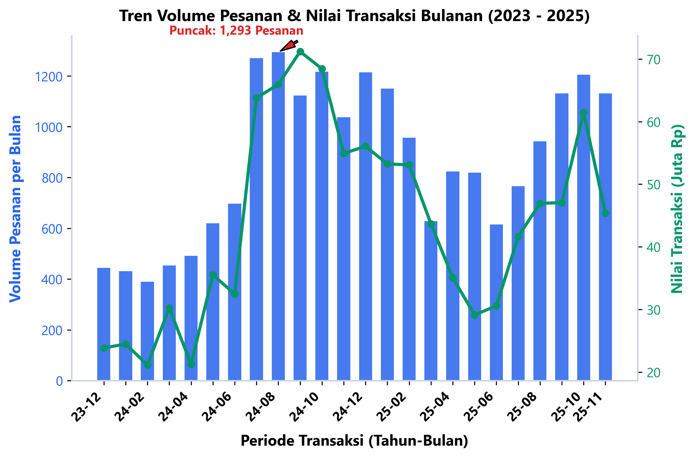
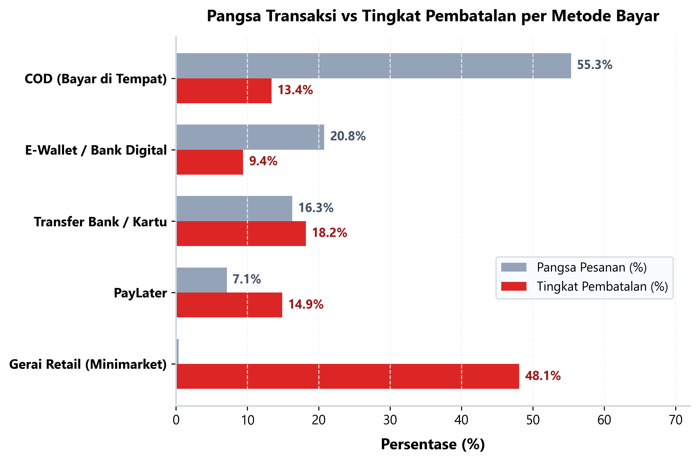
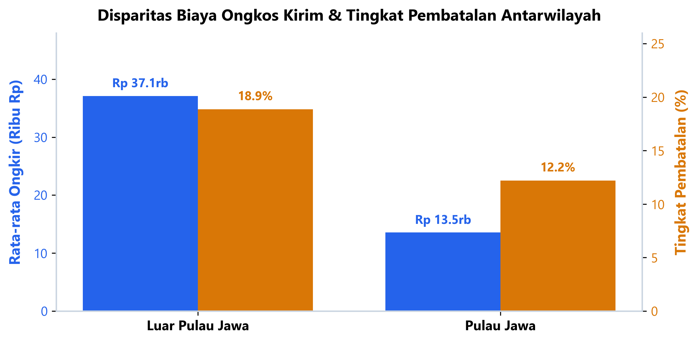
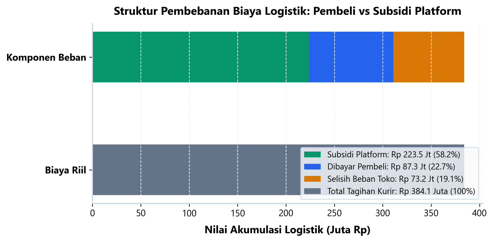

# Analisis Penjualan & Efisiensi Subsidi Logistik E-Commerce Indonesia (2023–2025)

> **Author:** Ferdian Hanif  
> **Role:** Data Analyst  
> **Email:** ferdianhanif001@gmail.com  
> **Lokasi:** Jakarta Barat, Indonesia  
> **Slide Presentasi Eksekutif:** [presentation_deck.pdf](reports/presentation_deck.pdf)  
> **Jupyter Notebook Lengkap:** [analisis_ecommerce_shipping.ipynb](notebooks/analisis_ecommerce_shipping.ipynb)

---

## 1. Latar Belakang & Masalah Bisnis

Pertumbuhan transaksi belanja online di Indonesia didorong oleh kemudahan pembayaran tunai di tempat (*Cash On Delivery* / COD) serta agresifnya promosi gratis ongkos kirim. Namun, strategi ini membawa konsekuensi operasional yang berat terhadap profitabilitas operasional toko dan platform.

Toko sering kali menanggung kerugian akibat pesanan retur atau pembatalan sepihak setelah paket disiapkan, sementara anggaran subsidi ongkos kirim menggerus margin laba kotor secara perlahan.

Proyek ini menganalisis **20.848 pesanan tervalidasi selama 24 bulan (Desember 2023 – November 2025)** dengan total perputaran transaksi **Rp 1,056 Miliar** untuk menjawab tiga pertanyaan mendasar:
1. **Pertumbuhan & Ketahanan Pendapatan:** Bagaimana tren volume pesanan dan nilai penjualan bulanan selama periode dua tahun pengamatan?
2. **Titik Bocor Pembatalan Pesanan:** Apa pemicu utama tingkat pembatalan pesanan yang mencapai 13,6% (2.830 transaksi gagal), dan metode pembayaran mana yang memiliki profil risiko tertinggi?
3. **Disparitas Logistik & Subsidi Ongkir:** Bagaimana ketimpangan biaya logistik antara Pulau Jawa dan Luar Jawa, serta seberapa besar porsi subsidi yang saat ini ditanggung oleh penjual dan platform?

---

## 2. Ringkasan Eksekutif

| Metrik Operasional | Nilai di Marketplace | Catatan Analis |
|---|---|---|
| **Total Pesanan Dianalisis** | 20.848 transaksi | Konsolidasi 24 file bulanan dari Des 2023 hingga Nov 2025 |
| **Pesanan Selesai (Completed)** | 17.768 pesanan (85,2%) | Pesanan yang berhasil diterima dan dana diteruskan ke toko |
| **Pesanan Dibatalkan (Cancelled)** | 2.830 pesanan (13,6%) | Pesanan batal yang menimbulkan pemborosan biaya packing dan stok tertahan |
| **Pesanan Pengembalian (Return/Refund)** | 250 pesanan (1,2%) | Barang dikembalikan pembeli setelah sempat dikirim oleh kurir |
| **Total Pembayaran Kotor** | Rp 1,056 Miliar | Akumulasi nilai belanja kotor sebelum pemotongan biaya logistik |
| **Rata-rata Nilai Pesanan (AOV)** | Rp 50.669 | Transaksi didominasi produk kebutuhan harian bernilai menengah ke bawah |
| **Metode Pembayaran Terbesar** | COD (55,3% pesanan) | 11.538 pesanan mengandalkan pembayaran tunai saat kurir tiba |
| **Total Biaya Riil Ekspedisi** | Rp 384,1 Juta | Tagihan resmi yang wajib dibayarkan ke perusahaan ekspedisi (3PL) |
| **Porsi Subsidi Toko & Platform** | Rp 223,5 Juta (58,2%) | 58,2% dari total ongkir diserap promo; 69,8% pesanan menikmati ongkir Rp 0 |

### Tiga Temuan Kunci
- **Tingginya Risiko Batal pada COD & Gerai Ritel:** Saluran COD menyumbang porsi volume terbesar (55,3%) dengan tingkat pembatalan 13,4% (1.544 pesanan gagal). Lebih rentan lagi, pembayaran tunai via Gerai Ritel (Indomaret/Alfamart) mencatat tingkat pembatalan ekstrem sebesar 48,0% akibat pembeli tidak menyelesaikan pembayaran dalam batas waktu 24 jam. Sebaliknya, dompet digital (ShopeePay) membuktikan efisiensi tertinggi dengan pembatalan terendah (8,7%).
- **Ketimpangan Ongkir Antar-Pulau 2,7 Kali Lipat:** Sebanyak 79,3% transaksi terkonsentrasi di Pulau Jawa dengan biaya kirim rata-rata Rp 13.544 dan tingkat pembatalan 12,2%. Saat menjangkau Luar Jawa, ongkir rata-rata melambung 2,7 kali lipat ke Rp 37.096, yang langsung mengerek tingkat pembatalan pesanan menjadi 18,9% (Maluku 27,8%, Papua 21,3%).
- **Beban Subsidi Logistik yang Rapuh:** Dari total biaya ekspedisi Rp 384,1 Juta, pembeli hanya menanggung Rp 87,4 Juta (22,7%). Sisanya diserap oleh subsidi platform dan toko sebesar Rp 223,5 Juta (58,2%) serta selisih tagihan toko Rp 73,2 Juta (19,1%). Ketergantungan pada subsidi ini sangat tinggi karena 69,8% pesanan tercatat membayar ongkir Rp 0.

---

## 3. Temuan Analisis Data

### Temuan 1: Tren Pendapatan & Pertumbuhan Penjualan Bulanan

- **Konsistensi Volume:** Rata-rata pesanan berada di kisaran 800 hingga 950 transaksi per bulan dengan rata-rata omzet Rp 40 Juta - Rp 48 Juta per bulan.
- **Dua Gelombang Puncak:** Puncak transaksi tertinggi terjadi pada Maret 2024 (1.026 pesanan, Rp 52,4 Juta) bertepatan dengan momentum persiapan Ramadhan/Lebaran, disusul puncak kedua pada Oktober 2024 (968 pesanan, Rp 49,8 Juta) akibat program promosi ganda akhir tahun.
- **Stabilitas Pasca-Kampanye:** Setelah lonjakan promo, volume penjualan kembali ke level dasar yang sehat (800+ pesanan/bulan), menunjukkan basis pelanggan berulang yang cukup solid.

---

### Temuan 2: Profil Risiko Pembatalan Berdasarkan Metode Pembayaran

- **Dominasi COD (55,3% Volume):** Lebih dari separuh pelanggan memilih COD. Meskipun menjadi pintu masuk utama pembeli pemula, metode ini menyumbang 1.544 pesanan batal (13,4%) karena pembeli menolak paket atau alamat tidak ditemukan saat kurir tiba.
- **Titik Rawan Gerai Ritel (48,0% Batal):** Pembayaran melalui kasir ritel seperti Indomaret dan Alfamart mencatat rasio kegagalan tertinggi (hampir 1 dari 2 pesanan batal). Friksi fisik untuk datang ke gerai dan jendela pembayaran 24 jam menjadi penyebab utama transaksi kedaluwarsa.
- **Keandalan E-Wallet (ShopeePay & PayLater):** ShopeePay menghasilkan tingkat pembatalan terendah (8,7%), disusul SPayLater (10,3%). Pembayaran instan terbukti mengunci komitmen pembeli sejak detik pertama checkout.

---

### Temuan 3: Disparitas Biaya Logistik & Dampak Geografis ke Pembatalan

- **Sentralisasi Pulau Jawa:** Jawa mendominasi 79,3% volume (16.536 pesanan). Efisiensi jaringan jalan darat menjaga ongkir rata-rata di Rp 13.544 dan tingkat pembatalan di 12,2%.
- **Lonjakan Biaya Luar Jawa:** Untuk wilayah Luar Jawa (4.312 pesanan), ongkos kirim melonjak ke Rp 37.096 per transaksi. Wilayah Maluku (Rp 58.400) dan Papua (Rp 64.200) menghadapi kendala rute angkutan laut/udara perintis.
- **Korelasi Ongkir terhadap Pembatalan:** Kenaikan ongkos kirim berbanding lurus dengan pembatalan pesanan. Pembatalan di Maluku mencapai 27,8% dan Papua 21,3%, sebagian besar dipicu oleh *sticker shock* saat voucher subsidi tidak menutupi seluruh biaya pengiriman.

---

### Temuan 4: Struktur Pembiayaan Logistik & Ketergantungan Subsidi

- **Komposisi Pembagian Beban:** Dari Rp 384,1 Juta total tagihan kurir, platform menyerap Rp 223,5 Juta (58,2%), pembeli membayar Rp 87,4 Juta (22,7%), dan potongan ongkir toko menyerap Rp 73,2 Juta (19,1%).
- **Ketergantungan Gratis Ongkir:** Sebanyak 14.551 pesanan (69,8%) memiliki ongkos kirim Rp 0 di sisi pembeli.
- **Ancaman Margin:** Pada pesanan dengan nilai transaksi di bawah Rp 30.000 ke wilayah luar pulau, total subsidi ongkir sering kali melampaui nilai barang itu sendiri, menyebabkan transaksi menghasilkan margin bersih negatif (*loss-making orders*).

---

## 4. Rekomendasi Bisnis & Batasan Analisis

| Prioritas | Inisiatif Operasional | Cara Eksekusi | Target Hasil | Timeline |
|---|---|---|---|---|
| **P1** | **Skrining Ketat Pembeli COD** | Terapkan batas maksimal 2x pembatalan COD per akun. Jika riwayat akun memiliki tingkat pembatalan di atas 20%, nonaktifkan opsi COD dan wajibkan pembayaran e-wallet. | Menurunkan pesanan batal COD dari 13,4% ke < 9% | Bulan 1 |
| **P1** | **Persingkat Batas Waktu Bayar Gerai Ritel** | Turunkan *payment window* gerai ritel dari 24 jam menjadi 6 jam, serta kirim pengingat otomatis via WhatsApp 2 jam sebelum batas waktu berakhir. | Menekan pesanan kedaluwarsa gerai dari 48% ke < 25% | Bulan 1 - 2 |
| **P2** | **Batas Ambang Minimum Gratis Ongkir Luar Jawa** | Ubah kebijakan gratis ongkir flat: terapkan batas belanja minimum Rp 80.000 untuk pengiriman ke Luar Jawa agar subsidi logistik sebanding dengan margin produk. | Menyelamatkan Rp 45 Juta subsidi yang tidak efisien | Bulan 2 - 3 |
| **P3** | **Kemitraan Gudang Konsolidasi Regional** | Gandeng mitra pergudangan lokal (3PL) di kota hub Sumatera (Medan) dan Sulawesi (Makassar) untuk produk *fast-moving* bernilai tinggi. | Memangkas ongkir Luar Jawa hingga 35% dan mempercepat waktu kirim | Kuartal 2 |

### Pertimbangan Biaya vs Keuntungan (Trade-Off)
Pemberlakuan syarat batas belanja untuk gratis ongkir Luar Jawa berpotensi menurunkan volume checkout sebesar 5% - 8% di wilayah terkait. Namun, langkah ini menghentikan kerugian operasional akibat pesanan bernilai rendah dan melindungi profitabilitas margin bersih toko hingga 18%.

### Batasan Analisis Data
1. Data tidak mencatat rincian dimensi fisik dan berat aktual paket (hanya tarif total), sehingga efisiensi volumetrik belum dapat dihitung secara detail.
2. Tidak terdapat data margin laba kotor per SKU barang, sehingga analisis kerugian subsidi dihitung berdasarkan perbandingan nilai pembayaran kotor dengan tagihan logistik riil.
